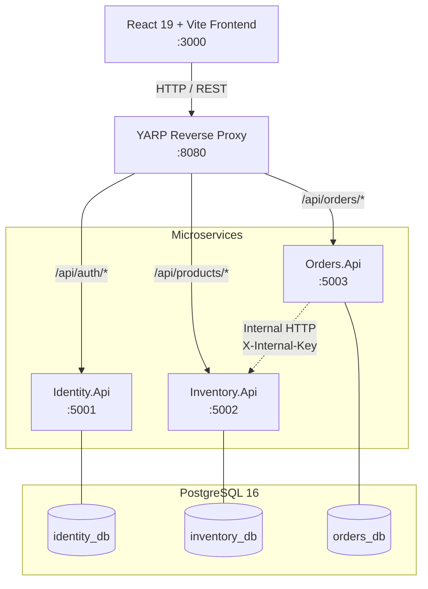

# ShipTrack — Order and Shipment Tracking Platform

> A production-style, microservices-based order and shipment tracking portfolio platform built with **.NET 10** (C#), **React 19**, **TypeScript**, **PostgreSQL 16**, **YARP Gateway**, and **Docker**.

---

## 1. System Architecture



---

## 2. Quickstart (Run in 3 Commands)

Ensure **Docker Desktop** is running, then:

```bash
# 1. Clone & copy environment configuration
Copy-Item .env.example .env

# 2. Build and launch all services and databases
docker compose --profile frontend up --build

# 3. Open the application in your browser
# Web App:      http://localhost:3000
# Gateway:      http://localhost:8080
```

### Default Admin Credentials (Seeded on startup)
- **Email:** `admin@shiptrack.dev`
- **Password:** `Admin@123456`

---

## 3. Technology Stack & Key Decisions

| Area | Technology | Reason & Highlights |
| :--- | :--- | :--- |
| **Backend** | .NET 10 (C# 14) Web API | Current LTS, nullable enabled, warnings as errors, central package management (`Directory.Packages.props`). |
| **Gateway** | YARP Reverse Proxy | High-performance reverse proxy for routing, correlation ID forwarding, and internal endpoint hiding. |
| **Databases** | PostgreSQL 16 | Dedicated database per service (`identity_db`, `inventory_db`, `orders_db`). |
| **Concurrency** | PostgreSQL `xmin` | Optimistic concurrency token prevents overselling on parallel stock reservation requests. |
| **Patterns** | CQRS-lite, Strategy, State | Clean separation of commands/queries; Shipping cost Strategy; Order lifecycle State machine. |
| **Frontend** | React 19 + TypeScript | Strict mode, Vite, TanStack Query, React Router, typed API client, react-hook-form + Zod foundation, and Tailwind CSS. |
| **Testing** | xUnit + NSubstitute + Testcontainers | Real PostgreSQL integration tests for concurrency and access control; Vitest + RTL + MSW on frontend. |

---

## 4. Port Allocations & Endpoints

| Service | Host Port | Internal Port | Purpose / Endpoints |
| :--- | :--- | :--- | :--- |
| **Web Frontend** | `3000` | `80` | React 19 Single Page Application |
| **YARP Gateway** | `8080` | `8080` | Entry point for all external client traffic |
| **Identity.Api** | `5001` | `8080` | `/api/auth/register`, `/api/auth/login` |
| **Inventory.Api** | `5002` | `8080` | `/api/products/*` (public), `/api/inventory/*` (internal) |
| **Orders.Api** | `5003` | `8080` | `/api/orders/*` (customer & admin order operations) |
| **PostgreSQL** | `5432` | `5432` | Relational storage for all three databases |

---

## 5. Running Automated Tests

```bash
# Run all backend unit and integration tests
dotnet test

# Run frontend tests
cd src/web && npm test
```

---

## 6. Documentation Index
- [Architecture Details](docs/ARCHITECTURE.md)
- [Architectural Decision Records (ADRs)](docs/DECISIONS.md)
- [Security & OWASP Top 10](docs/SECURITY.md)
- [SQL Optimization & Indexing Benchmark](docs/sql-optimization.md)
- [Project Report and Resume Summary](docs/PROJECT-REPORT.md)
- [25 Technical Interview Questions & Answers](docs/INTERVIEW_NOTES.md)
- [Phase-by-Phase Progress Log](docs/PROGRESS.md)
