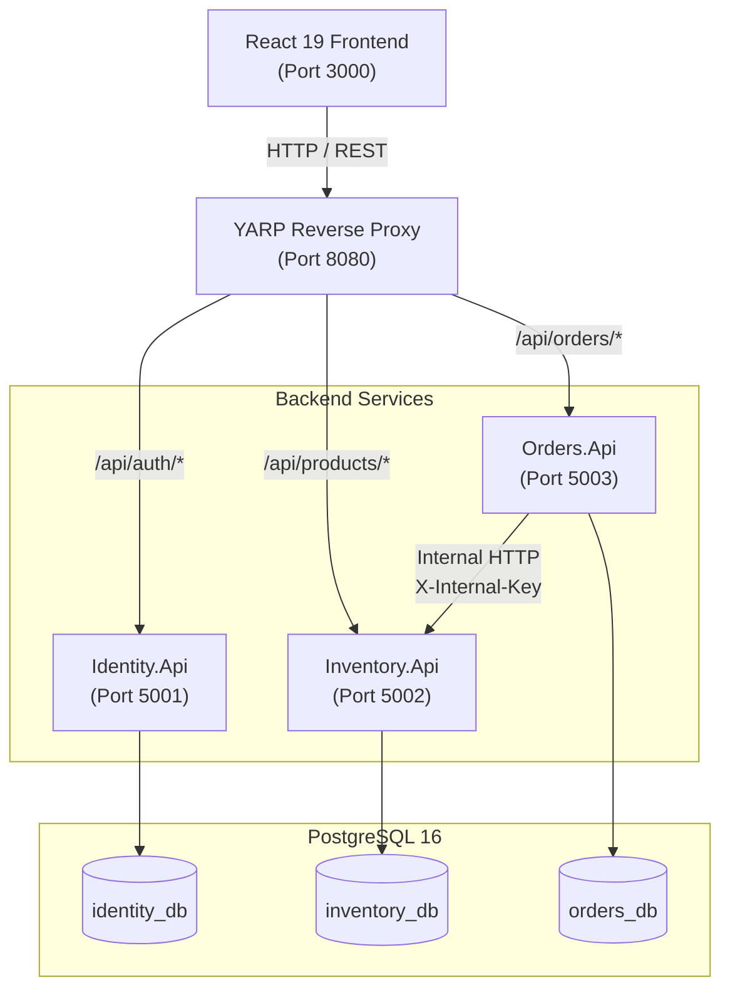

# ShipTrack Architecture

## 1. Overview
ShipTrack is an order and shipment tracking platform built with a microservices architecture. It demonstrates:
- Microservices boundary segregation (.NET 10 Web APIs)
- Gateway-routed architecture using YARP (Yet Another Reverse Proxy)
- Database-per-service pattern using PostgreSQL 16 (three independent databases)
- Resilient inter-service communication (Microsoft.Extensions.Http.Resilience)
- Modern frontend with React 19, TypeScript, TanStack Query, and Tailwind CSS

## 2. System Topology

## 3. Why Microservices Here?
While a simple monolith is often suitable for small systems, ShipTrack is designed to demonstrate microservice patterns:
1. **Independent Scalability:** Orders service experiences spike loads during checkout sales, while Identity has predictable authentication loads.
2. **Database Isolation:** Enforcing database-per-service prevents accidental table coupling. Neither Orders nor Identity can execute joins against Inventory tables.
3. **Autonomous Deployments:** Changes to pricing or inventory logic do not require redeploying the Identity service.

## 4. Database-per-Service Isolation
- `identity_db`: Owns customer credentials and role mappings.
- `inventory_db`: Owns products, pricing, stock levels, and concurrency tokens (`xmin`).
- `orders_db`: Owns orders, snapshots of purchased products, shipping data, and status history.

No service holds database credentials to another service's database.

## 5. Synchronous Inter-Service Calls & Trade-offs
Orders.Api synchronously calls Inventory.Api during order placement:
1. **Price Validation:** Fetches current unit prices (`GET /api/products/batch`).
2. **Stock Reservation:** Executes atomic all-or-nothing stock reduction (`POST /api/inventory/reserve`).

**Trade-offs:**
- *Simplicity vs Coupling:* Synchronous HTTP avoids broker infrastructure (e.g. RabbitMQ/Kafka) keeping operational footprint low, but introduces temporal coupling.
- *Mitigation:* We use typed `HttpClient` with `Microsoft.Extensions.Http.Resilience` (3s timeout, 2 retries with exponential backoff, circuit breaker).
- *Compensation:* If reserving succeeds but saving the order in `orders_db` fails, Orders.Api executes an immediate compensating call to `POST /api/inventory/release`.
